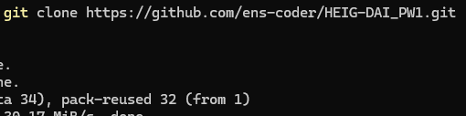

# Abstract


HEIG-DAI_PW1 is a CLI application developed by two students as part of the practical work number 1 for the DAI course at HEIG-VD.

Its purpose is to process images from a supported file format. It currently offers two type of processing:

- Color inversion: 
  - inverts the RGB values of each pixel.
- Black and white conversion: 
  - produces a black-and-white picture, with a choice of gradient (luminosity) made by user


>Supported formats:
>For now, the following image format is supported:
>- BMP

**Authors:**
- Noé Léderrey — [@noelebosss](https://github.com/noelebosss)
- Enis Sadiku <last name> — [@ens-coder](https://github.com/ens-coder)


# HEIG-DAI_PW1
HEIG-DAI_PW1 is designed to be used easily. You just need to have a JRE (at leat version 25.04
another version is not officialy supported).

The main structure of using software is:

`java -jar nameOfjar.jar nameOfcommand -optionIfAvaible -i filePathOriginalPicture -o destinationProcessedPicture `

The tree of pictures is:
```
img\
    |
    |___\original
    |
    |___\processed
```

- original have the non-processed pictures
- processed contain the processed pictures of original


**Example:**

For example, if you want to apply grey filter at 50% luminosity on ref.bmp picture:

`java -jar .\target\HEIG-DAI_PW1-1.0-SNAPSHOT.jar gradient -p -i .\img\original\ref.bmp -o .\img\processed\ref-invert.bmp`

> **note:** use the SNAPSHOT version jar because it will garanty you to have all the dependances
> in the jar

## Configuration - build
To use properly the software you need to configure correctly the environement. You need to follow
theses steps:

>**note:** we assume you that you have the correct configuration 
> with Git and stuffs - the tutorial has been tested on WSL Ubuntu and Windows 11

**1) clone the repo from GitHub:**

`https://github.com/ens-coder/HEIG-DAI_PW1.git`



**2) Maven:**

The project has been designed with Maven that means we strongly recommand you to follow this solution.

You need to generate environnement directly compatible with the software. First you have to tools 
to use depends on your OS:
- Windows:  `mvnw.cmd`
- Linux:  `mvnw`

> **note:** Maven may be download some requirements


**2.1) dev mode**

If you want, you can use another option for enhance project (DEV):

Package the project:
- Windows:  `mvnw.cmd package`
- Linux:  `mvnw package`

Clean file of target package:
- Windows:  `mvnw.cmd clean`
- Linux:  `mvnw clean`

Test:
- Windows:  `mvnw.cmd test`
- Linux:  `mvnw test`


**2.2) dependency of Maven**

The project contain theses dependencies:
- PICOCLI (interface)
- Junit (to do unit test)


**3) generate project and environnement**:

You need to open a command line (cmd or powershell on Windows and Terminal in linux):

- `.\mvnw.cmd package`
- `.\mvnw package` (for Linux)


# Sources
- DAI: courses
- https://en.wikipedia.org/wiki/BMP_file_format
- PRG2: laboratory

# Related link for the project:
- [PW1 - discussion](https://github.com/orgs/heigvd-dai-26/discussions/5)
- [PW1 - requierements](https://heigvd-dai-26.github.io/practical-work/pw1.html)
